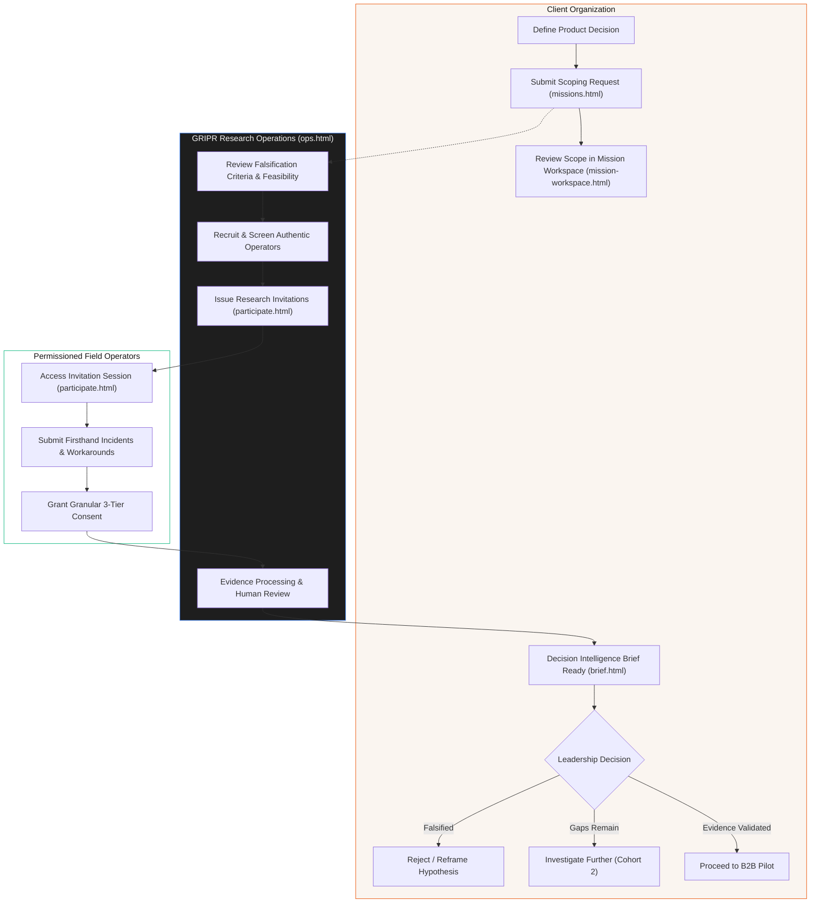

# GRIPR.STUDIO — Business Flow & Research Operations

**Document Version:** 2.0 (Phase 1 Refactor)  
**Scope:** End-to-End Operational and Decision Flow

---

## 1. End-to-End Flow Diagram

---

## 2. Detailed Operational Stages

### Stage 1: Define Research Decision (Client Organization)
- **Goal:** Shift from generic curiosity to a falsifiable business question.
- **Input:**
  - What product decision is being made? (e.g., "Choosing between building an Android app for fertilizer price tracking vs. an SMS dealer procurement network")
  - What does the team believe? (e.g., "Farmers will download an app to monitor daily fertilizer prices")
  - What evidence would change their minds? (e.g., "If farmers already have established credit ties with local dealers and cannot switch regardless of spot price differences")
- **Interface:** `missions.html` (multi-step scoping flow).

### Stage 2: Scope Review & Alignment (GRIPR Ops)
- **Goal:** Ensure the problem is amenable to firsthand qualitative inquiry and not a quantitative census.
- **Operational Gate:** Research lead verifies operator availability, screening criteria, and geographical clusters.
- **Interface:** `ops.html` (Scope Review tab).

### Stage 3: Invitation-Based Participant Recruitment
- **Goal:** Reach authentic practitioners, not professional survey respondents.
- **Mechanism:** Screened operators receive unique invitation links (e.g. `participate.html?invite=INV-AGRI-081`).
- **Incentive:** Fair honorarium for domain time (e.g. ₹1,500 per verified session), paid upon verification.

### Stage 4: Permissioned Research Sessions
- **Goal:** Collect concrete incidents rather than speculative opinions.
- **Prompts Focus on:**
  - What failed recently?
  - What was the specific workflow?
  - What was the financial or operational cost?
  - What manual workaround did you use?
- **Consent Decoupling:**
  - Consent A: Internal study analysis (mandatory)
  - Consent B: Inclusion of anonymized quote in executive brief (optional)
  - Consent C: Follow-up 1-on-1 interview / pilot invitation (optional)

### Stage 5: Gemini-Assisted Intelligence Structuring & Human Review
- **Goal:** Convert messy vernacular text/transcripts into structured intelligence while strictly flagging contradictions and unknowns.
- **Extraction Rules:**
  - Fact vs. Interpretation separation.
  - Flag contradictory reports (e.g., Participant 1 says dealers negotiate; Participant 4 says dealer price is fixed by caste network).
  - Explicitly document missing information (e.g., wholesale distributor margins were not directly observed).
- **Human Gate:** Researcher reviews extraction in `ops.html` before brief generation.

### Stage 6: Decision Intelligence Brief Delivery
- **Goal:** Deliver an executive-ready brief focused on decisions, not fluff metrics.
- **Sections:**
  - Executive Framing & Context
  - Verbatim Evidence with Translation
  - Workflow Friction Mapping
  - Contradiction Matrix
  - Responsible Research Limitations
  - Three Decision Options: Reject/Reframe | Investigate | Pilot
- **Interface:** `brief.html`.

---

## 3. Synthetic Demo Mode Specifications (Phase 1)
In Phase 1, all data is managed via synthetic fixtures (`js/fixtures.js`) and persisted in browser storage via `js/api.js`.
- Client requests created in `missions.html` are saved to local storage with status `Requested` or `Scoping`.
- Organization workspaces (`mission-workspace.html`) permit toggling between demonstration states (`Requested`, `Researching`, `Brief Ready`) to verify UX transitions.
- Participant responses in `participate.html` route directly to the ops desk queue.
- Decision Intelligence Brief (`brief.html`) renders structured evidence linked to fixture records `SES-401` through `SES-405`.
