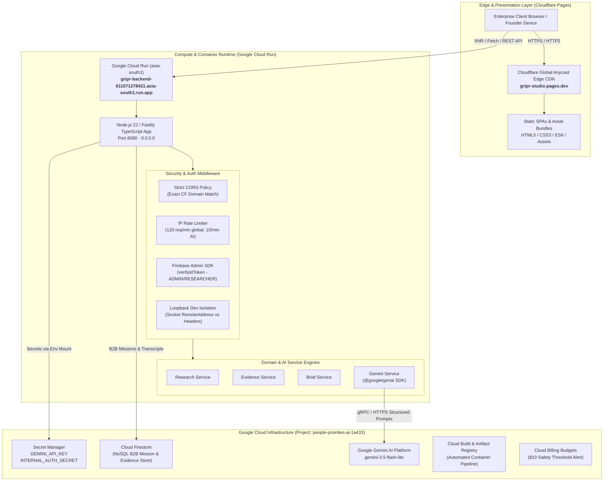
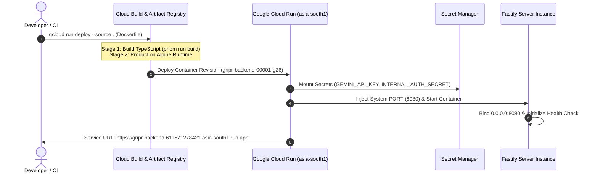

# 01 — Technical Architecture

## 1. Executive Summary & Topology

GRIPR.STUDIO is engineered using a **split-hosting cloud topology** optimized for zero idle cost, extreme global edge performance, robust enterprise security, and verified AI inference veracity.



---

## 2. Component Architecture & Layer Breakdown

### 2.1 Edge Presentation Layer (Cloudflare Pages)
- **Primary Domain:** `https://gripr-studio.pages.dev` (with preview environments `https://*.gripr-studio.pages.dev`).
- **Core Technology:** Vanilla semantic HTML5, modern CSS custom properties, and zero-dependency vanilla ES6 JavaScript modules.
- **Routing Engine (`js/api.js`):** Environment-aware resolution that detects runtime context:
  ```javascript
  const DEFAULT_CLOUD_RUN_URL = 'https://gripr-backend-611571278421.asia-south1.run.app/api';
  const DEFAULT_RAILWAY_URL = 'https://gripr-backend-production.up.railway.app/api';
  ```
  Resolves automatically to Cloud Run when executing on `*.pages.dev`, with transparent operator overrides via `window.__GRIPR_API_URL__` or `localStorage.getItem('gripr_api_base_url')`.
- **Zero Secret Exposure:** Zero private keys, API secrets, or database URLs are baked into the static artifact bundle. Validated by automated static build scripts (`scripts/build-pages.js`).

---

### 2.2 API Gateway & Application Server (Fastify & Node.js 22)
- **Framework:** Fastify v5 on Node.js 22 (Alpine Linux base container).
- **TypeScript:** Strict type checking with `tsconfig.json` (`target: ES2022`, `module: NodeNext`, `noImplicitAny: true`).
- **Process Binding:** Listens on system-injected `PORT` (8080) and binds to `0.0.0.0` inside container runtime.
- **Graceful Lifecycle Management:** Listens to `SIGTERM` and `SIGINT` signals sent by Cloud Run autoscaler to complete in-flight transactions before terminating.

---

### 2.3 Strict Multi-Tier Security Boundaries

#### A. Strict Production CORS Policy (`api/src/app.ts`)
- Configured with dynamic origin validation:
  ```typescript
  app.register(cors, {
    origin: (origin, cb) => {
      if (!origin) return cb(null, true);
      // Localhost / loopback origins strictly permitted in dev/test only
      if (env.isDev || env.isTest) {
        if (origin.includes('localhost') || origin.includes('127.0.0.1')) {
          return cb(null, true);
        }
      }
      // Exact deployed Cloudflare Pages production & preview subdomains
      if (origin === 'https://gripr-studio.pages.dev' || /^https:\/\/[a-z0-9-]+\.gripr-studio\.pages\.dev$/i.test(origin)) {
        return cb(null, true);
      }
      if (env.ALLOWED_ORIGINS.includes(origin)) {
        return cb(null, true);
      }
      return cb(new Error('CORS origin not allowed by policy'), false);
    },
    methods: ['GET', 'POST', 'PATCH', 'PUT', 'DELETE', 'OPTIONS'],
    allowedHeaders: ['Content-Type', 'Authorization', 'X-Requested-With', 'Accept', 'Origin'],
    credentials: true
  });
  ```
- Untrusted origins receive an immediate 500 error during preflight `OPTIONS` checks and are denied response headers.

#### B. IP Rate Limiting & Denial of Service Protection
- Registered globally with `@fastify/rate-limit`.
- General API: 120 requests/minute per client IP.
- AI & Invitation Endpoints: Stricter per-route rate limit (10 requests/minute for Gemini analysis; 20 requests/minute for invitation lookups).

#### C. Authentication & Token Verification (`api/src/middleware/authorization.ts`)
- **Public Endpoints:** Inquiry submission, health check, synthetic demo simulation, invitation response intake.
- **Privileged Endpoints:** Operations workbench queue, qualitative transcript moderation, draft brief authorization, live Gemini inference.
- **Authentication Standard:** Verified bearer token using **Firebase Admin SDK** (`verifyIdToken()`).
- **Role-Based Access Control (RBAC):**
  - `RESEARCHER`: Authorized to moderate participant sessions, inspect raw transcripts, run live qualitative extractions, and draft briefs.
  - `ADMIN`: Full platform configuration and tenant oversight.
  - `ORGANIZATION_USER`: Strictly tenant-isolated; authorized only to read published briefs belonging to their organization ID.

#### D. Loopback Development Isolation Guard (`api/src/routes/demo.ts`)
- In local development, demo mode allows unauthenticated execution **strictly** under verified loopback conditions:
  1. `NODE_ENV === 'development'`
  2. Server is explicitly bound to loopback (`127.0.0.1` / `::1`)
  3. Kernel socket remote address (`socket.remoteAddress`) is strictly loopback
  4. Zero proxy headers (`X-Forwarded-For`, `X-Forwarded-Host`, `Forwarded`) are present
- Public requests with spoofed headers attempting to mimic localhost are rejected with HTTP 401.

---

### 2.4 Multi-Mode Persistence Architecture

The backend implements an abstract repository pattern with interchangeable storage engines configured via `PERSISTENCE_MODE`:

| Storage Engine | Environment | Durability & Behavior |
|---|---|---|
| `DEMO_ONLY` | Production (Current) | Ephemeral in-memory synthetic demonstration. Returns HTTP 503 on real data intake to prevent accidental unpersisted data collection. |
| `cloud_firestore` | Production (Verified) | Persistent Google Cloud Firestore database under project `people-priorities-ai-1a433`. Requires verified ADC or Service Account credentials. |
| `local_file` | Development Only | Local JSON files in `api/data/firestore/`. Strictly prohibited in production by Zod schema refinement. |
| `memory` | Automated Vitest Unit Tests | In-memory `Map` structures for sub-millisecond, fully isolated unit test execution. |

#### Production Guardrail in `api/src/config/env.ts`:
```typescript
if (data.NODE_ENV === 'production' && data.PERSISTENCE_MODE === 'local_file') {
  ctx.addIssue({
    code: z.ZodIssueCode.custom,
    path: ['PERSISTENCE_MODE'],
    message: 'LOCAL_FILE_STORAGE is prohibited in production. Only cloud_firestore or demo_only are permitted.'
  });
}
```

---

## 3. Google Cloud Run Deployment Infrastructure



### 3.1 Container Configuration Details
- **Google Cloud Project:** `people-priorities-ai-1a433`
- **Region:** `asia-south1` (Mumbai, India)
- **Scaling Limits:**
  - `min-instances: 0` $\rightarrow$ Full scale-to-zero when idle (0 compute billing when no active traffic).
  - `max-instances: 1` $\rightarrow$ Strict upper concurrency limit preventing denial-of-wallet spikes.
- **Port Management:** Standard Cloud Run system-managed `PORT=8080`.
- **Public Invocations:** `--allow-unauthenticated` enabled; application-level security guards enforce RBAC on privileged API routes.

### 3.2 Secret Management Strategy
- Secrets are stored in Google Cloud **Secret Manager**:
  - `GEMINI_API_KEY:latest`
  - `INTERNAL_AUTH_SECRET:latest`
- Service account `611571278421-compute@developer.gserviceaccount.com` granted `roles/secretmanager.secretAccessor`.
- Secrets are mounted as environment variables inside Cloud Run, avoiding plain-text disk storage or git commits.

### 3.3 Cost & Budget Controls
- Linked Credit Billing Account: `019FB4-088ED5-B3691D` (`GDP Event Credit: buildathon day2 1`).
- Budget Alert: `1caba0eb-3fe7-406c-83c4-41bfc4e3a925` configured with thresholds at 50%, 80%, 100% current spend, and 100% forecasted spend on a $10 USD ceiling.
