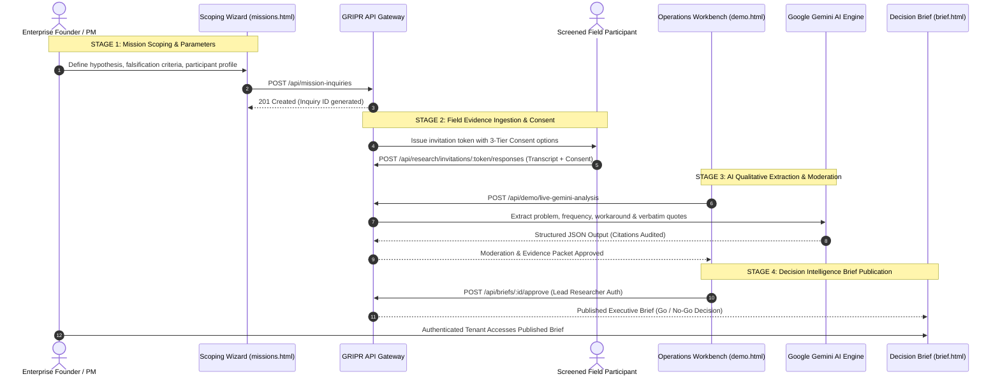

# 02 — Functional Implementation

## 1. The 4-Stage Research Lifecycle

GRIPR.STUDIO replaces informal founder intuition with a structured, audited 4-stage problem discovery and evidence extraction pipeline:



---

## 2. Detailed Lifecycle Stages

### Stage 1: Mission Scoping & Parameter Definition
1. **Hypothesis Formulation:** The commissioning organization articulates the precise business problem or market hypothesis under investigation (minimum 30 characters).
2. **Falsification Criteria:** An explicit, unambiguous operational threshold that proves the hypothesis false (e.g., *"If fewer than 15% of shop owners experience reconciliation errors, or if payment disputes take under 5 minutes weekly to resolve"*).
3. **Target Participant Profile:** High-granularity demographic and operational criteria (e.g., *"Kirana and small provision store owners operating in Tier-2/3 Indian cities for 5+ years"*).
4. **Geography & Sector:** Explicit geographical bounds (e.g., *Jaipur, Rajasthan*) and industry verticals (e.g., *Retail Commerce*).
5. **Commercial Commitment:** Acceptance of pilot pricing terms (₹49,000 for 5 qualified participant interviews delivered within 48 hours).

### Stage 2: Field Operator Recruitment & Qualitative Evidence Ingestion
1. **Operator Vetting:** Qualified participants are identified matching the scoping profile.
2. **Three-Tier Informed Consent:**
   - **Tier 1 (Mandatory):** *Study Processing Consent* — Permission to conduct the qualitative session and process transcripts.
   - **Tier 2 (Opt-in):** *Verbatim Quotation Consent* — Authorization to publish anonymized verbatim quotes in the client's decision brief.
   - **Tier 3 (Opt-in):** *Re-Contact Consent* — Voluntary permission allowing researchers to reach out for follow-up studies.
3. **In-Depth Qualitative Interview:** Conducted by research personnel focusing on real workflows, friction points, ledger overflows, and manual workarounds rather than speculative feature feedback.
4. **PII Segregation:** Participant contact data (phone numbers, full names) is segregated into private records and permanently excluded from the client's final brief.

### Stage 3: AI Qualitative Extraction & Researcher Moderation
1. **Gemini Extraction:** Raw transcripts and field notes are processed server-side through Google Gemini 3.5 Flash Lite.
2. **Extraction Dimensions:**
   - *Reported Core Problem* (with verbatim transcript quote)
   - *Occurrence Frequency* (with verbatim transcript quote)
   - *Financial Impact* (with verbatim transcript quote; classified strictly as `UNKNOWN` if unsupported by real metrics)
   - *Existing Workaround* (current manual coping mechanisms, e.g., dual notebooks, carbon slips)
   - *Emotional Valence* (frustration, anxiety, resignation, neutral)
3. **Quotation Veracity Check:** The system verifies that every extracted quote is a verbatim substring of the source interview text.
4. **Researcher Oversight:** Lead researchers inspect extraction confidence before promoting evidence into the client's brief draft.

### Stage 4: Decision Intelligence Brief Publication
1. **Synthesis Engine:** Evidence from all 5 participants is cross-analyzed to identify shared operational bottlenecks, frequency patterns, and root causes.
2. **Strategic Conviction (Go / No-Go):** The brief outputs a definitive strategic verdict:
   - **GO:** Hypothesis validated; friction is severe, frequent, and unaddressed by existing workarounds.
   - **NO-GO / PIVOT:** Falsification criteria met; users do not experience material friction, or social dynamics prevent software adoption.
3. **Tenant-Isolated Delivery:** Published briefs are accessible exclusively to authorized representatives of the commissioning organization (`ORGANIZATION_USER` matching tenant ID).

---

## 3. Dual Execution Architecture

| Dimension | Canonical Synthetic Demonstration | Enterprise Real Mission Intake |
|---|---|---|
| **Trigger** | Clicking *"Use Demo Data"* or visiting `/demo` | Manually submitting parameters on `/missions` |
| **Data Context** | Precomputed canonical Jaipur Kirana study (`PKT-401` to `PKT-405`) | Live business hypothesis entered by enterprise client |
| **Storage Engine** | Ephemeral in-memory synthetic store (`DEMO_ONLY`) | Cloud Firestore (`cloud_firestore`) |
| **Durability Guard** | Runs 100% locally/in-memory with full simulation | Throws HTTP 503 `DEMO_ONLY_MODE` if cloud storage is unattached |
| **AI Inference** | Live Gemini extraction with canonical packet fallback | Server-side Gemini extraction on client transcripts |
| **Commercial Review** | Shows simulated approval and operations walkthrough | Submits real inquiry to research intake queue |

---

## 4. Core Domain Entities & Zod Validation Schemas

### 4.1 Mission Inquiry Schema (`api/src/schemas/inquiry.schema.ts`)
```typescript
export const CreateMissionInquirySchema = z.object({
  orgName: z.string().min(2, 'Organization name must be at least 2 characters').max(100),
  contactPerson: z.string().min(2, 'Contact person must be at least 2 characters').max(100),
  contactEmail: z.string().email('Invalid email address'),
  role: z.string().min(2, 'Role must be at least 2 characters').max(100),
  sector: z.string().min(2).max(100).default('commerce'),
  industry: z.string().min(2, 'Industry must be at least 2 characters').max(100),
  decisionAtStake: z.string().min(10, 'Decision at stake must be at least 10 characters').max(500),
  problemToInvestigate: z.string().min(10, 'Problem to investigate must be at least 10 characters').max(500),
  hypothesis: z.string().min(30, 'Hypothesis must be at least 30 characters for high research quality').max(1000),
  falsificationCriteria: z.string().min(20, 'Falsification criteria must be at least 20 characters').max(1000),
  targetParticipantProfile: z.string().min(20, 'Target profile must be at least 20 characters').max(1000),
  geography: z.string().min(2, 'Geography must be at least 2 characters').max(100),
  budgetRange: z.string().optional().default('standard_pilot_49k'),
  pilotFeeAcknowledged: z.boolean().default(true),
  consentContact: z.boolean().refine(val => val === true, 'Contact consent is required'),
  consentPrivacy: z.boolean().refine(val => val === true, 'Privacy policy consent is required'),
});
```

### 4.2 Research Response & Consent Schema (`api/src/schemas/response.schema.ts`)
```typescript
export const SubmitResearchResponseSchema = z.object({
  transcript: z.string().min(50, 'Interview transcript must be at least 50 characters for meaningful analysis'),
  workaroundObserved: z.string().min(10, 'Workaround details required'),
  fieldNotes: z.string().optional(),
  consents: z.object({
    consentStudyProcessing: z.boolean().refine(v => v === true, 'Mandatory: participant must consent to study processing'),
    consentVerbatimQuotation: z.boolean().default(false),
    consentReContact: z.boolean().default(false)
  })
});
```

---

## 5. Complete REST API Route Matrix

| Method | Endpoint | Authorization | Description | Status Code |
|---|---|---|---|---|
| `GET` | `/api/health` | Public | System status, persistence engine metadata, and Gemini configuration. | `200` |
| `POST` | `/api/mission-inquiries` | Public | Submits a real scoping inquiry. In `DEMO_ONLY` mode, safely returns 503. | `201` / `503` |
| `GET` | `/api/mission-inquiries/:id` | Public | Retrieves scoping inquiry parameters and status by ID. | `200` / `404` |
| `POST` | `/api/missions` | Public (Rate Limited) | Initiates a structured scoping mission with validation. | `201` |
| `GET` | `/api/missions` | Authenticated | Lists tenant-isolated missions for an organization. | `200` |
| `GET` | `/api/missions/:id` | Tenant Guard | Retrieves mission details if authorized for caller's organization. | `200` / `403` |
| `GET` | `/api/research/invitations/:token` | Public (Enumeration Shield) | Verifies qualitative participant invitation token. | `200` / `404` / `410` |
| `POST` | `/api/research/invitations/:token/responses` | Public | Records participant qualitative interview response with 3-tier consent. | `201` / `400` |
| `POST` | `/api/demo/live-gemini-analysis` | Researcher / Admin Token | Runs server-side Google Gemini 3.5 Flash Lite qualitative analysis. | `200` / `401` / `502` |
| `GET` | `/api/operations/queue` | Researcher / Admin Token | Internal research operations workbench queue and review tasks. | `200` / `401` |
| `POST` | `/api/briefs/:id/approve` | Lead Researcher Token | Approves draft brief and publishes it to the client organization. | `200` / `401` |
| `GET` | `/api/briefs/:id` | Tenant Guard | Delivers published Decision Intelligence Brief to client tenant. | `200` / `403` |
