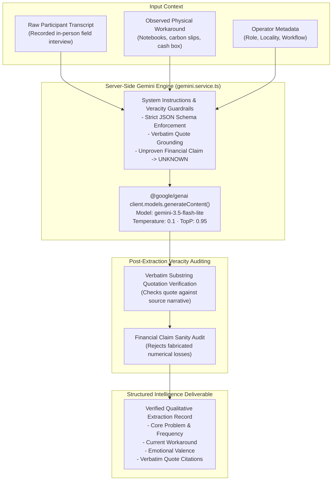

# 03 — Google AI Integration

## 1. Google Gemini Architecture & Model Selection

GRIPR.STUDIO integrates **Google Gemini 3.5 Flash Lite** (`gemini-3.5-flash-lite`) using the official Google Gen AI SDK (`@google/genai`).



### 1.1 Why Gemini 3.5 Flash Lite?
1. **Sub-Second Latency:** Delivers rapid structured extraction (~1.2s to 2.4s) suitable for interactive research workbenches and live demonstration workflows.
2. **Deterministic Schema Adherence:** Native support for strict JSON output schemas (`responseMimeType: 'application/json'` and `responseSchema`) eliminating malformed markdown or syntax errors.
3. **High Context Verbatim Fidelity:** Unmatched ability to isolate exact, unedited vernacular quotes (including Hinglish and regional Hindi nuances) from conversational transcripts without paraphrasing.
4. **Cost & Sustainability:** Minimal token cost footprint, operating comfortably within hackathon and startup credit allocations.

---

## 2. Server-Side SDK Implementation (`api/src/services/gemini.service.ts`)

The integration runs exclusively on the backend server; no client browser ever receives the `GEMINI_API_KEY` or communicates directly with Google's API endpoints.

```typescript
import { GoogleGenAI, Type, Schema } from '@google/genai';
import { env } from '../config/env.js';

export class GeminiService {
  private client: GoogleGenAI | null = null;
  public readonly isConfigured: boolean;

  constructor() {
    const apiKey = env.GEMINI_API_KEY;
    if (apiKey && apiKey.trim() !== '' && apiKey !== 'YOUR_GEMINI_API_KEY_HERE') {
      this.client = new GoogleGenAI({ apiKey });
      this.isConfigured = true;
    } else {
      this.isConfigured = false;
    }
  }

  async extractEvidence(
    narrative: string,
    workaround: string,
    role: string,
    workflow: string,
    options: { forceLive?: boolean; allowMockFallback?: boolean } = {}
  ): Promise<GeminiExtractionResult> {
    if (!this.client) {
      if (options.forceLive) {
        const error: any = new Error('Gemini API is not configured. Provide GEMINI_API_KEY.');
        error.statusCode = 503;
        error.name = 'GeminiUnavailableError';
        throw error;
      }
      return this.getFallbackExtraction(narrative, role, workflow);
    }
    // Execution continues with client.models.generateContent()
  }
}
```

---

## 3. Strict Structured Extraction Schema

Extraction output is constrained to a formal JSON Schema, guaranteeing that required fields, enums, and nested structures are validated at generation time:

```typescript
const qualitativeExtractionSchema: Schema = {
  type: Type.OBJECT,
  properties: {
    reportedProblem: {
      type: Type.OBJECT,
      properties: {
        summary: { type: Type.STRING },
        sourceQuote: { type: Type.STRING }
      },
      required: ['summary', 'sourceQuote']
    },
    frequency: {
      type: Type.OBJECT,
      properties: {
        category: {
          type: Type.STRING,
          enum: ['DAILY', 'WEEKLY', 'MONTHLY', 'RARE', 'UNKNOWN']
        },
        sourceQuote: { type: Type.STRING }
      },
      required: ['category', 'sourceQuote']
    },
    financialImpact: {
      type: Type.OBJECT,
      properties: {
        category: {
          type: Type.STRING,
          enum: ['HIGH', 'MEDIUM', 'LOW', 'UNKNOWN']
        },
        statedLoss: { type: Type.STRING },
        sourceQuote: { type: Type.STRING }
      },
      required: ['category', 'sourceQuote']
    },
    currentWorkaround: {
      type: Type.OBJECT,
      properties: {
        description: { type: Type.STRING },
        sourceQuote: { type: Type.STRING }
      },
      required: ['description', 'sourceQuote']
    },
    emotionalValence: {
      type: Type.STRING,
      enum: ['FRUSTRATED', 'ANXIOUS', 'RESIGNED', 'NEUTRAL']
    }
  },
  required: [
    'reportedProblem',
    'frequency',
    'financialImpact',
    'currentWorkaround',
    'emotionalValence'
  ]
};
```

---

## 4. Veracity & Anti-Hallucination Framework

### 4.1 Verbatim Source Transcript Quotation Auditing
A primary danger of applying LLMs to qualitative research is *quote embellishment*—the model rewrites what a customer said to sound more dramatic. GRIPR prevents this by executing algorithmic citation auditing:

```typescript
const verifyQuote = (quote: string | null | undefined, transcript: string): boolean => {
  if (!quote) return true;
  const normNarrative = transcript.toLowerCase().replace(/\s+/g, ' ');
  // Supports multi-segment ellipsis quotes (e.g. "Main Jaipur mein... galti hoti hai")
  const parts = quote.toLowerCase().split('...').map(p => p.trim()).filter(Boolean);
  return parts.every(part => normNarrative.includes(part));
};
```
If a returned citation does not match the participant's exact recorded words, the quotation check fails, warning the researcher before brief compilation.

### 4.2 Financial Claim Sanity Constraint
Early-stage founders often hallucinate financial urgency (e.g., claiming a shop loses 20% of revenue to credit friction). In the canonical Kirana study, participant *Ramesh Kumar* states:  
> *"Exact financial loss mujhe nahi pata."* (I don't know the exact financial loss.)

The system prompt explicitly commands Gemini:
> **RULE:** If the participant does not state a verified numerical rupee or dollar loss in the transcript, you MUST classify `financialImpact.category` as `"UNKNOWN"` and state `"Unspecified by participant"`. DO NOT estimate or fabricate financial losses.

In testing and live verification, Gemini correctly tags the financial loss as `UNKNOWN`, preventing unwarranted commercial decisions based on fabricated figures.

---

## 5. Security & Fail-Closed Behavior

1. **No Silent Mock Degradation (`forceLive: true`):** When live AI analysis is requested on `/api/demo/live-gemini-analysis`, mock fallback is prohibited. If the Gemini API key is missing or quota is exhausted, the server returns an explicit non-2xx status code (`HTTP 502` or `HTTP 503`) rather than silently returning mock data labeled as `LIVE_GEMINI`.
2. **Authenticated Access:** Only authorized `ADMIN` or `RESEARCHER` roles can trigger live Gemini analysis over public networks.
3. **Secret Storage:** Managed via Google Cloud Secret Manager (`GEMINI_API_KEY`) and mounted directly to the container runtime.
