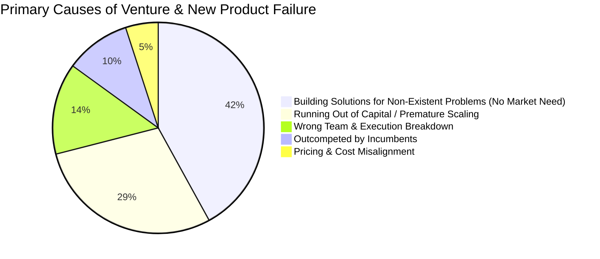
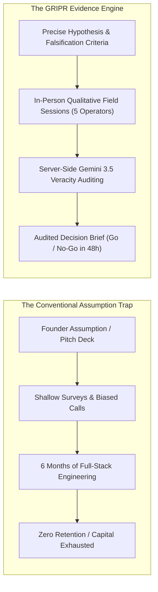
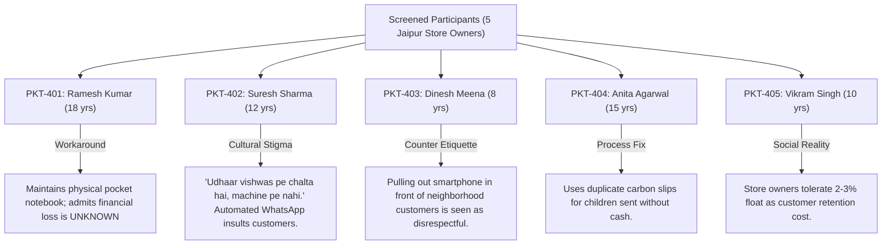

# 04 — Problem and Solution

## 1. The Core Industry Problem: Why Ventures Fail

According to longitudinal research by CB Insights and Harvard Business School, over **42% of venture-backed startups and new product initiatives fail for a single primary reason: No Market Need**.

### The Anatomy of the Validation Trap
1. **Confirmation Bias in Founder Interviews:** When founders interview potential customers, they inadvertently "pitch" their solution rather than investigating daily operational realities. Customers politely agree (*"Sure, that sounds useful"*), which founders mistake for commercial intent.
2. **Quantitative Analytics Blindspot:** Telemetry and product analytics (Mixpanel, PostHog, Google Analytics) track what users click *inside an existing application*, but cannot detect what users do *outside software* or why they abandon a workflow for a paper ledger.
3. **The Superficial Survey Problem:** Online surveys (Typeform, SurveyMonkey) suffer from self-selection bias and produce superficial checkboxes that fail to expose emotional resistance, social stigma, or entrenched physical workarounds.
4. **The "Synthetic AI Customer" Trap:** Emerging LLM-based "synthetic persona" tools generate imaginary customer feedback that hallucinates enthusiasm, reinforcing founder delusions with fabricated statistical confidence.

---

## 2. The GRIPR Solution: First-Party Qualitative Evidence

GRIPR.STUDIO is a **B2B Qualitative Problem Intelligence Platform & Evidence Engine**. It acts as an independent truth layer between product teams and market reality.

### 2.1 The Core Operating Tenets
1. **Falsification-First Methodology:** Missions do not seek confirmation; they define explicit falsification criteria (e.g., *"If delinquency is under 2%, or if manual reconciliation takes under 5 minutes weekly, the problem does not justify software"*).
2. **Firsthand Field Operators:** Research sessions are conducted with real participants in their actual work environments (e.g., retail store owners behind physical cash counters), capturing ambient operational context.
3. **Focus on Physical Workarounds:** GRIPR measures current workarounds (dual diaries, carbon slips, verbal reminders) as the truest indicator of unmet demand. If an operator is not already using a manual workaround, the problem rarely creates willingness to pay.
4. **Audited Citation Grounding:** Every insight in a brief is backed by verbatim source transcript citations, audited by Google Gemini with strict veracity controls.

---

## 3. Commercial Model & Unit Economics

GRIPR operates an **Experimental B2B Pilot Mission Model** designed for rapid enterprise purchasing without long procurement cycles:

| Dimension | Pilot Mission Specification |
|---|---|
| **Price Point** | **₹49,000 INR** (~$590 USD) all-inclusive flat fee |
| **Deliverable Scope** | 5 qualified, screened qualitative participant interviews |
| **Geography** | Targeted Tier-1, Tier-2, or Tier-3 Indian hubs (e.g., Jaipur retail cluster) |
| **Turnaround SLA** | **48 Hours** from scoping approval to published Decision Brief |
| **Participant Honorarium** | Direct financial honorarium paid to field participants |
| **Client Deliverable** | Executive Decision Intelligence Brief + Transcripts + Veracity Audit |
| **Enterprise ROI** | Prevents spending ₹15,00,000 – ₹50,00,000 ($18k – $60k) on wasted engineering sprints |

---

## 4. Real-World Case Study: The Jaipur Kirana Ledger Study

### Commissioning Context
- **Hypothesis:** Small grocery and provision stores in Jaipur suffer 15% revenue loss from informal credit ledgers (*khatabook*), and would eagerly pay for automated WhatsApp payment reminder software.
- **Scoping Parameters:** 5 independent Kirana store owners in Jaipur operating for 8 to 18 years.

### What the Ground Evidence Revealed

### The Strategic Brief Verdict: PIVOT / NO-GO
- **The Finding:** Software startups building automated payment dunning for Kirana merchants fail because credit in neighborhood retail is **relationship-driven social credit**, not transactional accounts receivable. Automated WhatsApp reminders cause customers to defect to competitors across the street.
- **The Value Delivered:** The commissioning team killed their planned WhatsApp dunning app *in 48 hours for ₹49,000*, saving 4 months of engineering time and ₹20,00,000 in seed capital.
