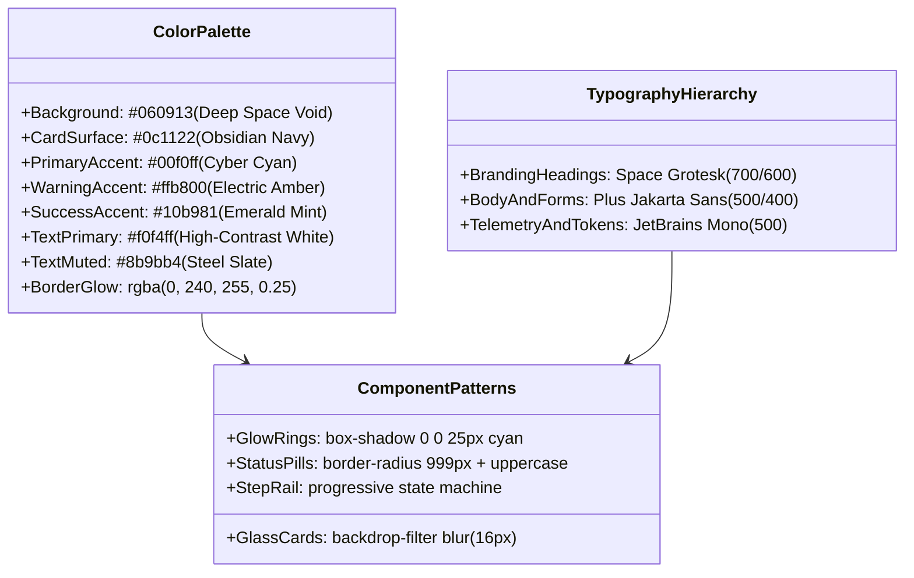
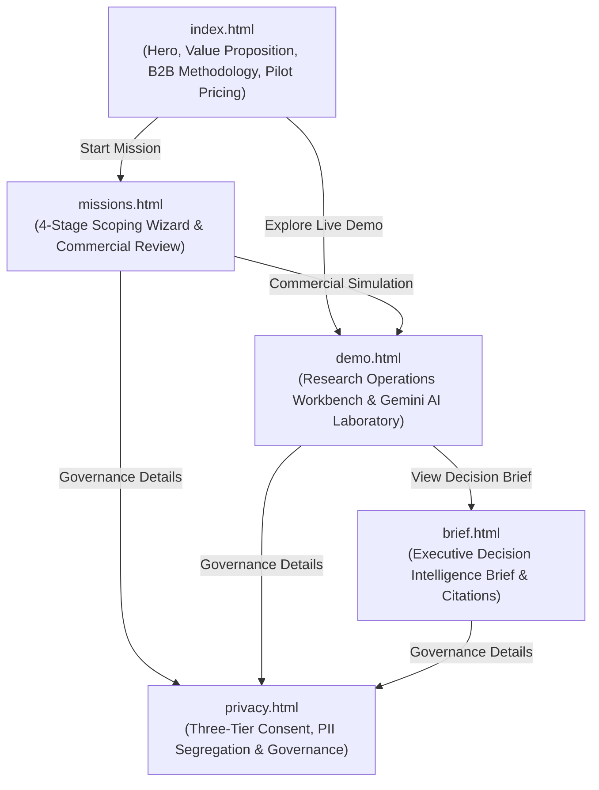

# 05 — UX, UI and Usability

## 1. Design System & Brand Identity

GRIPR.STUDIO is built upon a **Dark Cyber-Terminal Design System** engineered to project authority, empirical rigor, and technological precision.



---

## 2. Information Architecture & Navigation

The platform organizes complex qualitative research workflows into five purpose-built views:



---

## 3. Usability Engineering & Interaction Highlights

### 3.1 4-Step Scoping Wizard with Progressive Disclosure (`missions.html`)
- Instead of overwhelming founders with a massive 20-field form, GRIPR splits scoping into progressive stages:
  1. *Step 1: Organization & Business Context* (Name, Role, Sector, Decision at Stake).
  2. *Step 2: Problem & Research Scope* (Problem description, Target participant profile, Geography).
  3. *Step 3: Hypothesis & Falsification Criteria* (Core hypothesis, Specific falsification metrics).
  4. *Step 4: Commercial Terms & Pilot Agreement* (Pilot fee acknowledgment, 3-tier consent flags).
- Real-time step progress indicator (`stepRail`) visually communicates completion status.

### 3.2 Single-Click Demonstration Injection (`useDemoDataBtn`)
- Evaluation fatigue is eliminated for investors, partners, and prospective clients:
  - Clicking `"Use Demo Data"` instantly populates all 14 form fields with the canonical *Jaipur Kirana Retail Ledger* dataset.
  - Automatically activates the synthetic guided walkthrough mode, enabling users to test the full 4-stage pipeline without typing manual inputs.

### 3.3 Live Server Reload Shield & Form Navigation Protection
- **The Problem:** In development and split-hosting environments, file changes or native form submission can trigger full browser reloads, wiping entered form state.
- **The Engineering Fix:**
  1. All form submissions strictly invoke `event.preventDefault()`.
  2. The submission button is an explicit `type="button"` with granular JS event listeners.
  3. Live Server reload shielding prevents reload triggers:
     ```javascript
     const isLocalDev = window.location.hostname === 'localhost' || window.location.hostname === '127.0.0.1';
     if (!isLocalDev) return;
     // Live server WebSocket interceptor shields active session state
     ```
  4. `sessionStorage` caching preserves confirmed inquiry IDs (`sessionStorage.getItem('gripr_confirmed_inquiry')`), so users never lose their confirmation token on refresh.

### 3.4 Interactive Decision Intelligence Brief (`brief.html`)
- High-level executive synthesis accompanied by deep-dive evidence drawers:
  - **Verdict Hero:** Unambiguous `[ GO ]` or `[ PIVOT / NO-GO ]` status pill with statistical confidence score.
  - **Operational Bottleneck Ranking:** Visual bars displaying frequency and severity across the cohort.
  - **Audited Verbatim Quotations:** Every finding features an expandable quote drawer displaying the participant's exact words, location, and emotional valence.

---

## 4. Accessibility & Responsiveness

| Standard | Implementation in GRIPR.STUDIO |
|---|---|
| **Color Contrast (WCAG AAA)** | Text-to-background contrast exceeds 7:1 across all primary body text and form inputs (`#f0f4ff` on `#060913`). |
| **Typography Scaling** | Fluid typographic scale using `clamp()` ensures seamless readability across mobile (375px), tablet (768px), laptop (1440px), and 4K displays. |
| **Focus States & Keyboard Nav** | All interactive inputs, buttons, and drawer toggles feature glowing cyan focus rings (`outline: 2px solid var(--cyan)`). |
| **Mobile Scoping Wizard** | Single-column reflow on screens under 768px with sticky bottom navigation buttons. |
