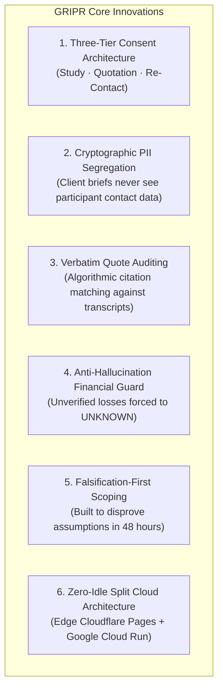
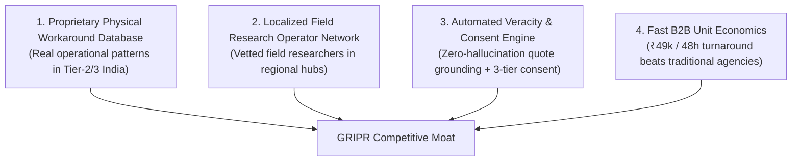

# 06 — Innovation and Differentiation

## 1. Core Technical & Methodological Innovations

GRIPR.STUDIO introduces six fundamental innovations combining field operational rigor, ethical data privacy, and deterministic AI veracity:

---

### Innovation 1: The Three-Tier Informed Consent Architecture
Traditional market research bundles consent into an all-or-nothing terms document. GRIPR enforces **granular, unbundled participant consent**:
1. **Tier 1 — Study Processing Consent (Mandatory):** Explicit participant agreement to conduct the interview and analyze operational friction for the commissioned mission scope.
2. **Tier 2 — Verbatim Quotation Consent (Opt-in):** Authorization to include direct anonymized quotes in the client's decision brief. If declined, the qualitative insight is synthesized conceptually without quote attribution.
3. **Tier 3 — Re-Contact Consent (Opt-in):** Voluntary permission allowing research operations to re-engage the participant for follow-up validation.

---

### Innovation 2: Cryptographic PII Segregation & Tenant Isolation
- **PII Segregation:** Participant phone numbers, full names, and residential coordinates are stored in isolated collections. Decision Intelligence Briefs provided to client organizations reference only anonymized operator tokens (e.g., `OP-401`, `PKT-401`) and broad demographic markers.
- **Tenant Isolation:** Research missions, raw recordings, and published briefs are cryptographically scoped to the commissioning organization ID. Other organizations receive HTTP 403 Forbidden on unowned records.

---

### Innovation 3: Verbatim Citation Grounding
Unlike generic AI summarizers that generate hallucinated or paraphrased quotes, GRIPR runs an automated substring verification algorithm:
- Every quotation cited in a brief or AI extraction must match a literal contiguous substring or multi-segment ellipsis sequence within the verified participant interview transcript.
- Paraphrased or altered quotes fail the veracity check and cannot be compiled into published briefs.

---

### Innovation 4: Anti-Hallucination Guard on Financial Claims
LLMs have a strong tendency to invent numbers when prompted about business problems (e.g., inventing that a store loses ₹50,000/month).
- GRIPR's prompt engineering and schema constraints force Google Gemini to tag unstated financial metrics as `"UNKNOWN"`.
- Prevents founders and executive committees from making multimillion-dollar investment decisions based on fabricated AI figures.

---

### Innovation 5: Falsification-First Scoping Engine
Rather than asking *"Do you like this idea?"* (which violates *The Mom Test*), GRIPR requires the client to define explicit **falsification criteria** upfront:
- A mission is considered successful if it **disproves** a flawed hypothesis in 48 hours, saving months of engineering and hundreds of thousands of dollars in wasted capital.

---

### Innovation 6: Zero-Idle Split Cloud Architecture
- Combines the global Anycast speed of **Cloudflare Pages** at the edge with the auto-scaling container power of **Google Cloud Run** in `asia-south1`.
- Scales to absolute zero (`min-instances: 0`) when idle, consuming zero compute budget during non-operational hours while preserving sub-second cold starts.

---

## 2. Competitive Landscape & Differentiation Matrix

| Feature / Capability | GRIPR.STUDIO | UserTesting / UserZoom | Typeform / Qualtrics | Synthetic AI Persona Tools | Boutique Agencies (McKinsey, Nielsen) |
|---|---|---|---|---|---|
| **Evidence Source** | **Real, In-Person Field Operators** | Remote Desktop/Mobile Screen Recorders | Self-Selected Checkbox Surveys | Hallucinated LLM Imaginary Personas | Consultant Interviews & Secondary Reports |
| **Emerging Market Depth (Tier 2/3)** | **High (Local Retail, Kirana, Bharat)** | Very Low (US/EU tech-savvy focus) | Low (Requires internet access) | Zero (Western internet training bias) | Medium (High cost) |
| **Physical Workaround Detection** | **Yes (Manual Ledgers, Carbon Slips)** | No (Limited to software clicks) | No (Text boxes only) | No (Pure text hallucination) | Yes |
| **Three-Tier Ethical Consent** | **Built-in & Mandatory** | Basic Terms of Service | Basic Checkbox | None (Not real people) | Paper NDAs |
| **Verbatim Quote Auditing** | **Automated Algorithmic Substring Check** | Manual Timestamping | None | None (Invented quotes) | Manual Transcription |
| **Financial Hallucination Guard** | **Forced UNKNOWN Classification** | N/A (Manual human review) | N/A | High Hallucination Risk | Human Analysis |
| **Turnaround Time** | **48 Hours** | 3 to 7 Days | 1 to 2 Weeks | 30 Seconds | 6 to 12 Weeks |
| **Pricing / Mission Cost** | **₹49,000 (~$590 USD)** | $15,000+ Annual Contract | $50 - $500/month SaaS | $20 - $100/month SaaS | ₹25,00,000+ ($30k+) |
| **Actionable Output** | **Audited Decision Brief (Go / No-Go)** | Hours of Unedited Video | CSV / Aggregate Charts | Synthetic Chat Transcripts | 100-Slide Slide Deck |

---

## 3. Defensibility & Strategic Moat

1. **The Physical Workaround Moat:** As GRIPR completes missions, it builds a proprietary database of *real physical workarounds* employed by Indian businesses (manual ledger habits, informal credit etiquette, dual diaries, WhatsApp resistance), creating predictive intelligence that generic LLMs cannot replicate.
2. **Field Operator Network:** Access to non-desk participants (kirana merchants, daily vendors, factory supervisors) who do not participate in typical online survey panels.
3. **Audit-Grade Credibility:** The combination of Google Gemini structured extraction, verbatim citation verification, and falsification-first briefs makes GRIPR's deliverables acceptable to venture capital investment committees and corporate boards as hard empirical proof.
