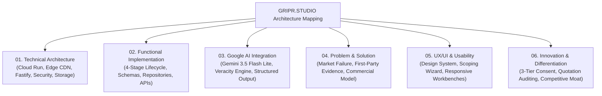

# GRIPR.STUDIO — Comprehensive Architecture & Strategic Mapping

## System Documentation Index

This directory contains the exhaustive, production-grade architecture, implementation, and strategic blueprint for **GRIPR.STUDIO** — the AI-powered first-party qualitative problem intelligence platform.

---

### Architectural Modules

---

### Document Directory

1. **[01_TECHNICAL_ARCHITECTURE.md](file:///Users/divyanshdusad/Downloads/GRIPR.STUDIO/mapping/01_TECHNICAL_ARCHITECTURE.md)**
   - Global Cloud Topology: Cloudflare Pages Edge Frontend & Google Cloud Run Fastify Backend
   - Network & Security Boundaries (CORS, Rate Limiting, Kernel Peer IP Validation)
   - Secret Management (Google Cloud Secret Manager & Zod Validation)
   - Multi-Mode Repository Architecture (`DEMO_ONLY`, `CloudFirestore`, `LocalFileStorage`, `Memory`)
   - Resource & Cost Optimization (`min-instances: 0`, `max-instances: 1`, Budget Alerts)

2. **[02_FUNCTIONAL_IMPLEMENTATION.md](file:///Users/divyanshdusad/Downloads/GRIPR.STUDIO/mapping/02_FUNCTIONAL_IMPLEMENTATION.md)**
   - Complete 4-Stage Research Lifecycle (Scoping $\rightarrow$ Field Evidence $\rightarrow$ AI Synthesis $\rightarrow$ Brief)
   - Dual Execution Modes: Canonical Jaipur Kirana Synthetic Demo vs. Enterprise Real Mission Intake
   - Data Models & Zod Schemas (`Mission`, `MissionInquiry`, `ResearchResponse`, `DecisionIntelligenceBrief`)
   - Complete REST API Route Matrix & Authorization Contracts

3. **[03_GOOGLE_AI_INTEGRATION.md](file:///Users/divyanshdusad/Downloads/GRIPR.STUDIO/mapping/03_GOOGLE_AI_INTEGRATION.md)**
   - Google Gemini 3.5 Flash Lite Selection & SDK Implementation (`@google/genai`)
   - Strict Structured Output Extraction Schema (`responseSchema`)
   - Veracity & Anti-Hallucination Framework: Verbatim Source Transcript Quotation Auditing
   - Unknown Financial Impact Classification Guardrail

4. **[04_PROBLEM_AND_SOLUTION.md](file:///Users/divyanshdusad/Downloads/GRIPR.STUDIO/mapping/04_PROBLEM_AND_SOLUTION.md)**
   - The Startup Failure Problem: Why 90% of ventures build for phantom problems
   - The Qualitative Evidence Gap: Limitations of quantitative telemetry & survey bias
   - The GRIPR Solution: First-party qualitative evidence engine with vetted operators
   - Commercial Pilot Economics: ₹49,000 / $590 for 5 operators & 48-hour turnarounds
   - Real-World Case Study: Jaipur Kirana Retail Ledger Friction

5. **[05_UX_UI_AND_USABILITY.md](file:///Users/divyanshdusad/Downloads/GRIPR.STUDIO/mapping/05_UX_UI_AND_USABILITY.md)**
   - Dark Cyber-Terminal Design System (`#060913`, `#00f0ff` Cyan, `#ffb800` Amber)
   - Information Architecture & Page-Level Hierarchy
   - Usability Engineering: Step Rails, Zero-Reload Form Submission, Live Server Reload Shields
   - Accessibility, Responsive Design Breakpoints, and Kinetic Visualizations

6. **[06_INNOVATION_AND_DIFFERENTIATION.md](file:///Users/divyanshdusad/Downloads/GRIPR.STUDIO/mapping/06_INNOVATION_AND_DIFFERENTIATION.md)**
   - Three-Tier Informed Consent Framework (Study Processing, Quotation, Re-Contact)
   - Cryptographic PII Segregation & Multi-Tenant Isolation
   - Verbatim Source Quote Grounding Algorithm
   - Competitive Landscape & Feature Comparison Matrix (UserTesting, Qualtrics, Synthetic AI Tools)

---

### Deployment Reference Summary
- **Live Frontend (Edge CDN):** [https://gripr-studio.pages.dev](https://gripr-studio.pages.dev)
- **Live Backend (Google Cloud Run):** [https://gripr-backend-611571278421.asia-south1.run.app](https://gripr-backend-611571278421.asia-south1.run.app)
- **Google Cloud Project:** `people-priorities-ai-1a433` (Region: `asia-south1`)
- **Rollback Service:** [https://gripr-backend-production.up.railway.app](https://gripr-backend-production.up.railway.app)
- **Test Suite Status:** 17 Passed Suites / 127 Passing Tests (100% Green)
- **Git HEAD:** Synced on `main` and `phase-3`
